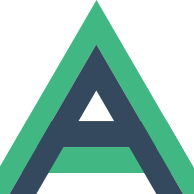

# aloha-vue



---

Aloha is a Vue.js-based, highly customizable, internationalized framework for helping developers write code faster and more efficiently, with a special focus on accessibility.

## Quick start

New project with Vite, translations, icons, a form and a table, ready to run:

```bash
npx degit ilia-brykin/aloha/starter my-app
cd my-app
npm install
npm run dev
```

## Installation

Aloha-vue can be installed using npm, yarn, or pnpm:

```bash
# Using npm
$ npm install aloha-vue

# Using yarn
$ yarn add aloha-vue

# Using pnpm
$ pnpm add aloha-vue
```

## Styles

The styles for aloha-vue are provided in two formats:

- Precompiled CSS: `dist/aloha-vue.css`
- SCSS source: `scss/aloha-vue.scss`

### Example: Adding styles in `main.js`

```javascript
import { createApp } from "vue";
import App from "./App.vue";
import "aloha-vue/dist/aloha-vue.css";

const app = createApp(App);
app.mount("#app");
```

## Usage

### Example: Importing and using a simple component (AButton)

```javascript
import { createApp } from "vue";
import App from "./App.vue";
import { AButton } from "aloha-vue";
import "aloha-vue/dist/aloha-vue.css";

const app = createApp(App);

app.component("AButton", AButton);

app.mount("#app");
```

In your Vue template:

```html
<template>
  <div>
    <a-button @click="onClick">Click Me</a-button>
  </div>
</template>

<script>
export default {
  methods: {
    onClick() {
      alert("Button clicked!");
    },
  },
};
</script>
```

## AI agents

The package contains documentation for AI coding agents (Claude Code, Cursor, Copilot, Codex…): `node_modules/aloha-vue/AGENTS.md` (setup, translations, filters, styles) and one markdown file per docs page in `node_modules/aloha-vue/llms/`. Add this line to the `AGENTS.md` / `CLAUDE.md` of your project:

```md
UI library: aloha-vue. Before using it, read node_modules/aloha-vue/AGENTS.md.
```

The same docs are online for agents without the package: [llms.txt](https://ilia-brykin.github.io/aloha/llms.txt) (index) and [llms-full.txt](https://ilia-brykin.github.io/aloha/llms-full.txt) (all pages in one file).

Reusable workflow skills are included in the package:

- [client-aloha-vue](skills/client-aloha-vue/SKILL.md): using components, plugins, translations, HTTP helpers, and styles.
- [client-aloha-vue-modal](skills/client-aloha-vue-modal/SKILL.md): building modal forms and confirmations.

The skills complement the generated API documentation; register them with your coding agent to make them discoverable.

After changes in the docs, regenerate the files with `npm run build-llms`.

## TypeScript

The package contains the types of all components and their props (`types/aloha-vue.d.ts`), so editors (Volar, vue-tsc) and agents see wrong or misspelled props. JetBrains IDEs read `web-types.json`. After changes in the props, regenerate both files with `npm run build-types`.

## Development

### Documentation

```bash
# Serve with hot reloading at localhost:9000
# Requires Node.js v22.12.0
$ cd docs
$ npm i
$ npm run dev
```

## Documentation

The documentation can be found in [DOCS](https://ilia-brykin.github.io/aloha/). Each component has a dedicated demo page outlining both basic and advanced usage, along with an overview table.

[Aloha documentation](https://ilia-brykin.github.io/aloha/) is available in English, German, Spanish, French, Arabic, Italian, Russian, Croatian, Ukrainian, Dutch, and Polish.

## Tests

```bash
# Start all tests
$ npm run test

# Start one test
$ npm run test src/filters/__tests__/filterList.test.js
```

## Sponsor / Support

[PROUNIX](https://prounix.de/)

## License

aloha-vue is released under the [MIT](https://github.com/ilia-brykin/aloha/blob/master/LICENSE) license.
